# Interdimensional Cable TV

**A Rick and Morty–themed home screen and screensaver for Android TV.** Every app becomes a numbered cable channel, flipping between them shows TV static, and when the TV sits idle it goes "off the air".

It was built for one 2021 realme 55" Android TV (32-bit, 1.35 GB RAM) in a single afternoon of vibe coding with [Claude Code](https://claude.com/claude-code), and it now runs as that TV's everyday home screen.

[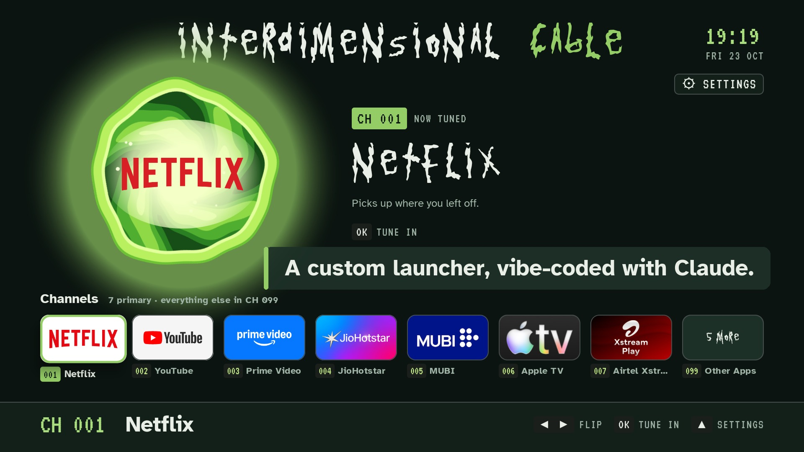](docs/media/launch-video.mp4)

▶ [Watch the 21-second launch video](docs/media/launch-video.mp4) (MP4, made with the `/brag` skill)

> Fan project. Not affiliated with or endorsed by Adult Swim, Warner Bros. Discovery or the makers of Rick and Morty. No show artwork is included in this repo.

---

## Before and after

| Stock Android TV home | Interdimensional Cable |
|---|---|
| 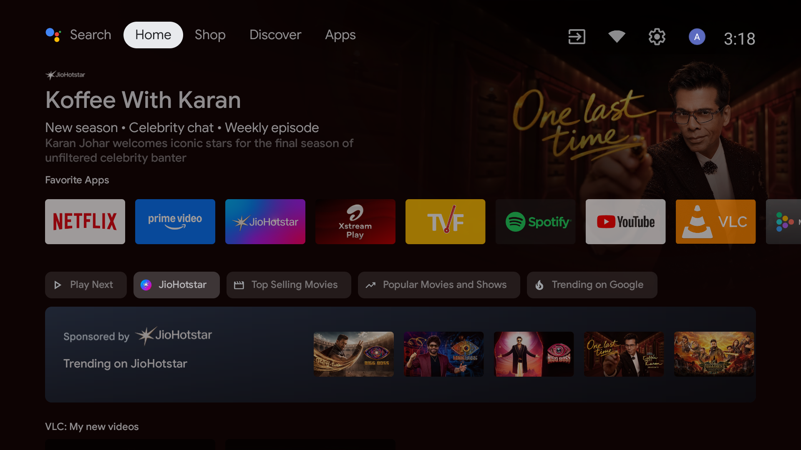 | 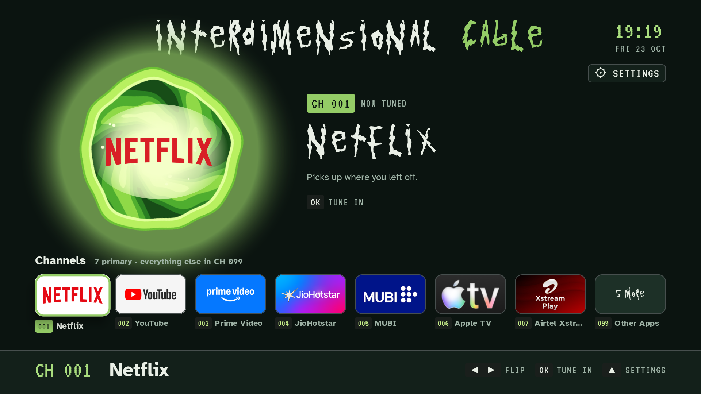 |
| Sponsored rows, recommendation feeds, and an ad-tracking service running in the background. | Your seven apps as channels, a spinning portal with the focused app's logo, a live clock. |

## What it does

### Home screen: every app is a channel
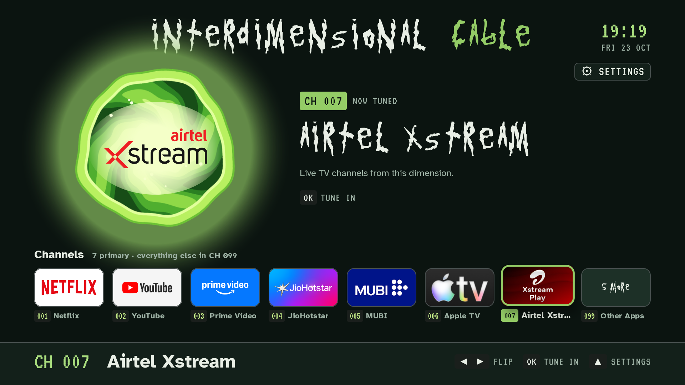

- Seven favourite apps on **CH 001–007**, everything else in **CH 099 Other Apps**.
- A cel-shaded portal (original render, see [`design/portal`](design/portal)) spins behind the focused app's logo.
- ◀ ▶ flips channels, OK tunes in, ▲ opens Settings. A short static flash plays between channels.
- Channel copy is written for the theme: CH 002 YouTube is "Subscriptions and the long tail of the multiverse."

| CH 005 MUBI | Living room (daytime) theme |
|---|---|
| 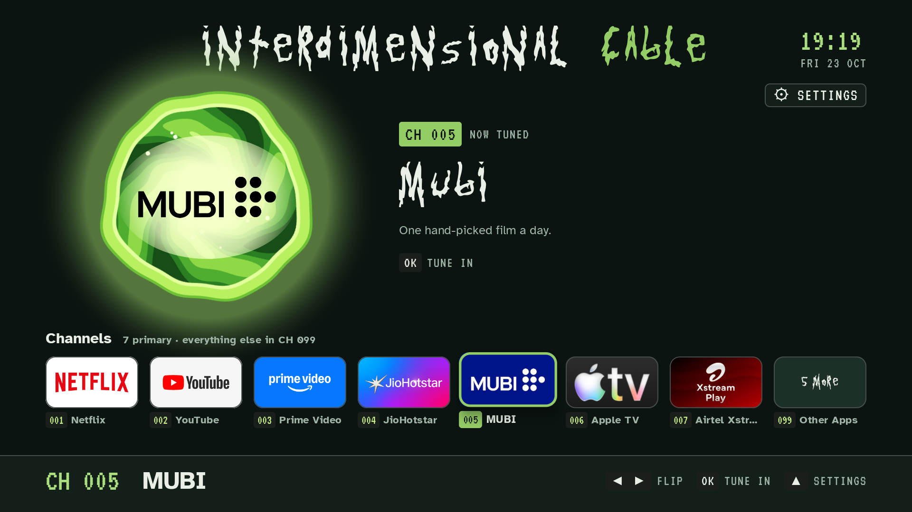 | 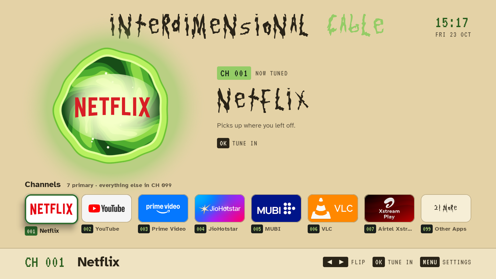 |

### Other Apps (CH 099)
Every other installed app, A–Z, on CH 100 and up. Press ☰ Menu on any of them to promote it to the main seven.

| Before debloat (21 apps) | After debloat (4 apps) |
|---|---|
| 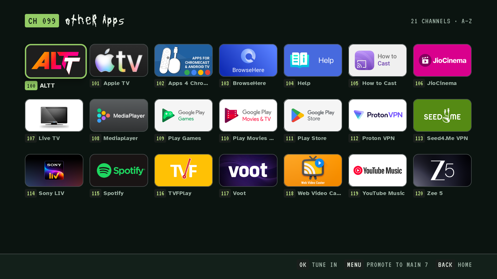 | 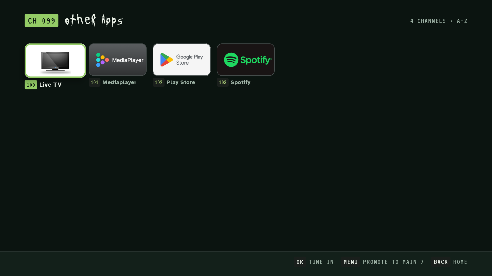 |

### Screensaver: Interdimensional Cable is off the air
A real Android screensaver (DreamService) with three scenes that take turns: **Portal idle**, **Channel surf** (your photos and wallpapers, flipping every 30 s), and **Off the air** (a test card). Clock, date and live weather from Open-Meteo.

| Portal idle | Off the air |
|---|---|
| 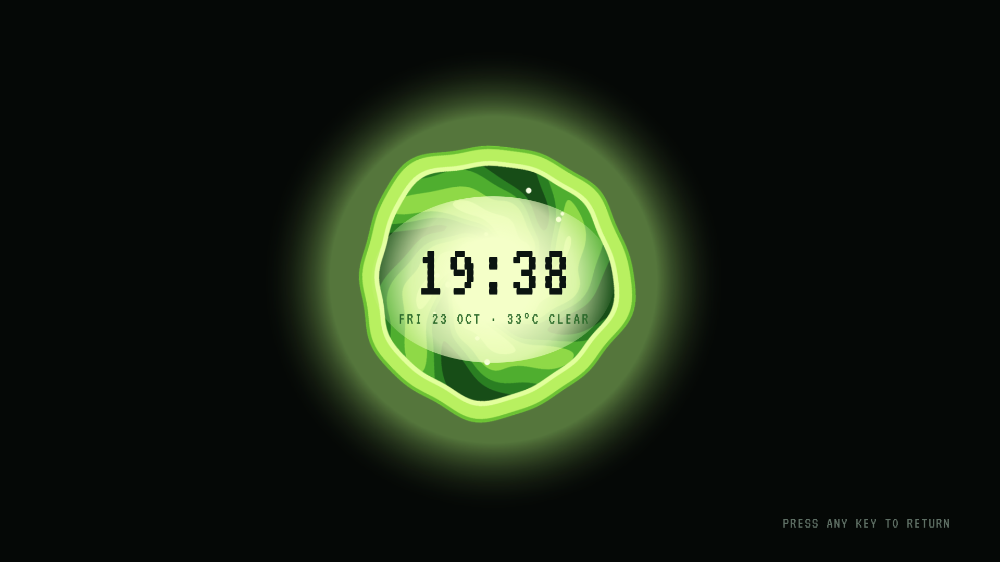 | 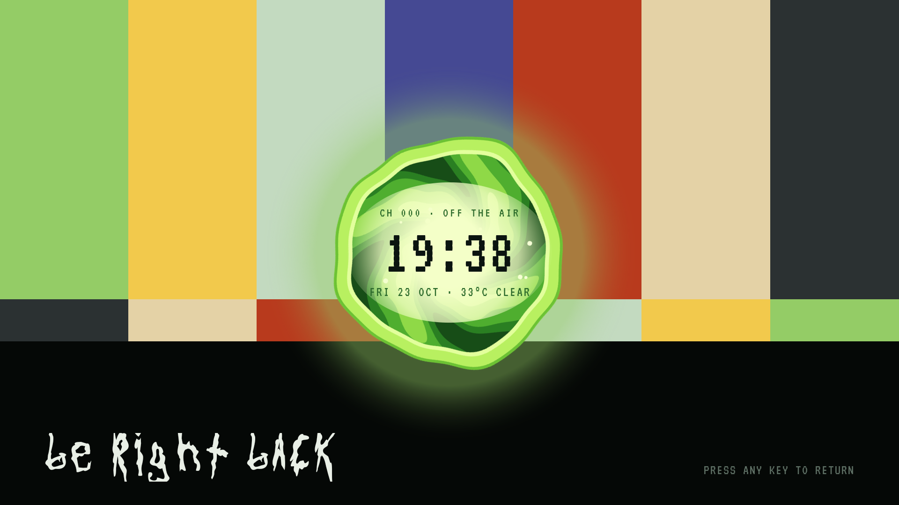 |

### Settings, on the TV
Theme (Night / Living room), your own home title, portal logo style, reduced motion, static on/off, home channel order, screensaver scenes and timing, and shortcuts to the stock home and the TV's own settings.

| Settings | Rename your cable box |
|---|---|
| 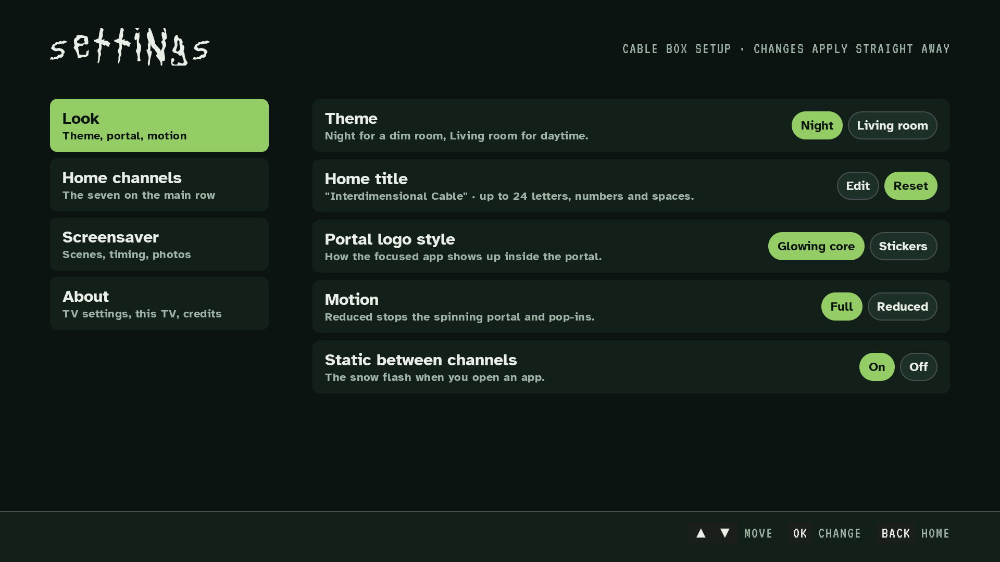 | 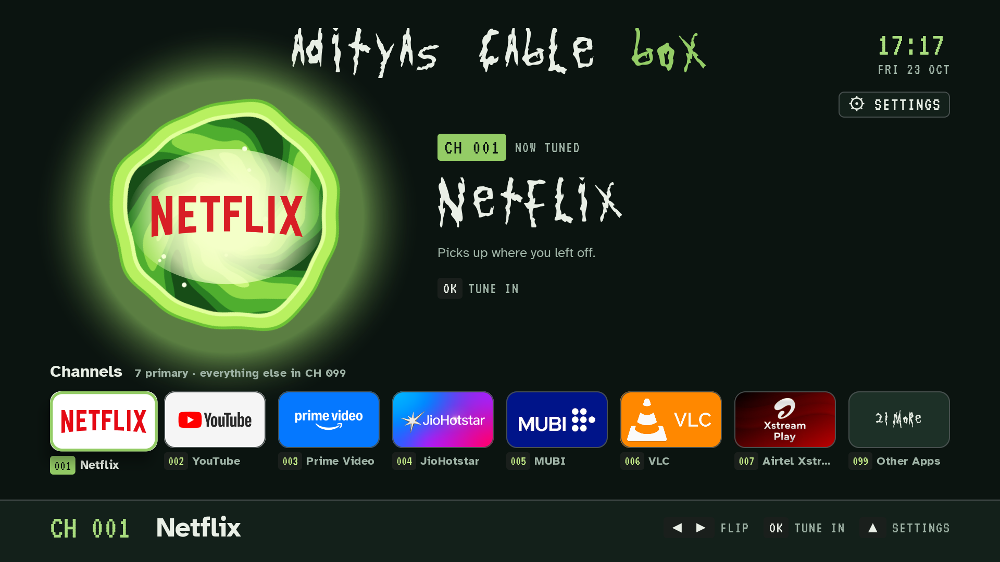 |

## Numbers (measured on the realme TV)

| | |
|---|---|
| Home button to our screen (warm) | 150 ms median |
| Memory | 53 MB |
| Janky frames while browsing | 0.51 % (p99 11 ms) |
| APK size | 0.5 MB (2.9 MB with logos and wallpapers) |
| Free RAM after the optional debloat | 430 → 578 MB |

## Quick start

You need an Android TV (classic Android TV home) running Android 11 or later, a computer with JDK 17 and the Android SDK, and `adb`.

```bash
git clone https://github.com/akishtawal/rick-and-morty-tv
cd rick-and-morty-tv/android
./gradlew :app:assembleBench
adb connect <tv-ip>:5555
adb install -r app/build/outputs/apk/bench/app-bench.apk
```

Then, on the TV:
1. **Settings → Device Preferences → Accessibility → Interdimensional Cable Home button → On.** This is what makes the Home button open this launcher.
2. **Settings → Device Preferences → Screen saver → Interdimensional Cable** for the screensaver.

The full walkthrough is in **[GUIDE.md](GUIDE.md)**: enabling network debugging, adding the display font and your own wallpapers, choosing your channels, the optional debloat, and troubleshooting.

## Make it look like the video

Three things are not in this repo because they are not mine to share:

- **The display font, "Get Schwifty"** by jonizaak, a free fan font. Download it from FontSpace and drop it in as `android/app/src/main/res/font/get_schwifty.ttf`. Without it the titles use VT323.
- **Wallpapers for Channel surf.** Use your own photos (`tools/push_photos.sh`) or add images to `android/app/src/main/assets/wallpapers/`. Official Rick and Morty art: the show's pages on [TMDB](https://www.themoviedb.org/tv/60625-rick-and-morty/images/backdrops), the [Rick and Morty Fandom wiki](https://rickandmorty.fandom.com/) and [Adult Swim](https://www.adultswim.com/videos/rick-and-morty). Keep it on your own TV.
- **Transparent app logos for the portal.** Without them the portal shows each app's own TV banner. Add PNGs named `<package>.png` to `android/app/src/main/assets/logos/` (Wikimedia Commons has many brand logos).

## How it works

- **Kotlin, classic Android Views, one APK**, `armeabi-v7a`-friendly, API 30. Views beat Jetpack Compose on this weak TV (436 vs 669 ms cold start).
- **Taking over the Home button.** Android TV won't let a sideloaded launcher outrank the stock one (system priority 2 vs 0), so an accessibility service listens for the Home key and for the stock launcher's windows, and brings this launcher forward. The stock launcher is never disabled. **Hold Home for 2 seconds** to get the stock home back.
- **Screensaver** is a standard `DreamService`, so the TV's idle timer and power settings keep working.
- **No ads, no accounts, no tracking.** The only network call is the weather (Open-Meteo, no key).

## Repo layout

```
android/            Gradle project (app module: home/, saver/)
tools/              debloat.sh, push_photos.sh, measure.sh
design/portal/      the portal render script and its PNGs
docs/               screenshots and the launch video
licenses/           font licences (OFL)
```

## Credits

- Built by [Aditya Kishtawal](https://github.com/akishtawal) with Claude Code.
- Fonts bundled: [VT323](https://fonts.google.com/specimen/VT323) and [Atkinson Hyperlegible](https://fonts.google.com/specimen/Atkinson+Hyperlegible), both SIL Open Font License ([licenses/](licenses)).
- Weather: [Open-Meteo](https://open-meteo.com/).
- Rick and Morty is a trademark of its owners; this is a non-commercial fan project.

## License

Code and original assets (portal render, screenshots of this UI, launch video and its soundtrack): [MIT](LICENSE). App names and logos visible in screenshots belong to their owners.
